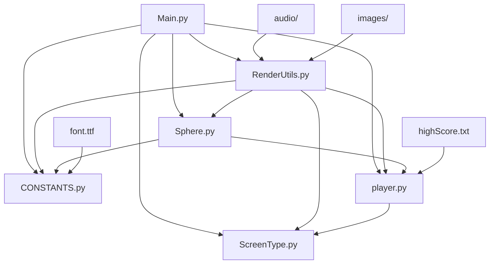
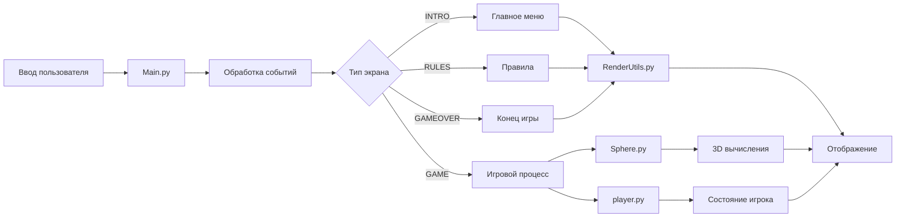
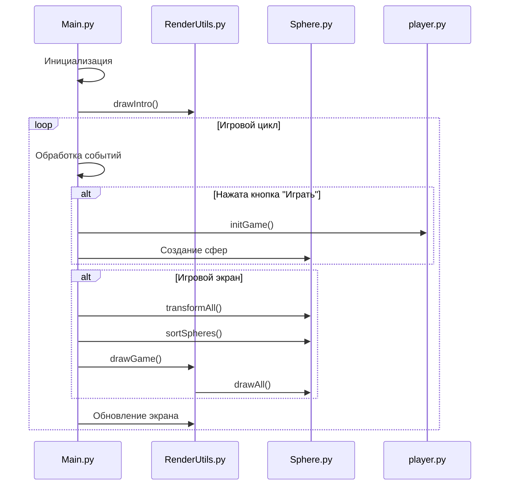

# 3D Космический Стрелок

Полнофункциональная 3D-игра-шутер, созданная с нуля на Python с использованием Pygame и NumPy. Игра демонстрирует продвинутые концепции 3D-графики, включая проекцию, вращение и трансформации в реальном времени.

## 📁 Структура проекта

```
3D-Game-From-Scratch-With-Python-master/
├── 📁 audio/                    # Аудиофайлы
│   ├── button.ogg              # Звук нажатия кнопки
│   ├── gameover.ogg            # Звук окончания игры
│   ├── music.mp3               # Фоновая музыка
│   ├── point.ogg               # Звук попадания
│   ├── rocket.ogg              # Звук двигателя
│   └── shot.ogg                # Звук выстрела
├── 📁 images/                   # Графические ресурсы
│   ├── crosshair.png           # Прицел
│   ├── crosshair-target.png    # Прицел при наведении
│   ├── gameover.jpg            # Экран окончания игры
│   └── rulesBG.png             # Фон экрана правил
├── 📄 CONSTANTS.py             # Константы и настройки
├── 📄 font.ttf                 # Шрифт игры
├── 📄 highScore.txt            # Файл рекордов
├── 📄 Main.py                  # Главный игровой цикл
├── 📄 player.py                # Логика игрока
├── 📄 RenderUtils.py           # Утилиты рендеринга
├── 📄 ScreenType.py            # Типы экранов
└── 📄 Sphere.py                # Логика сфер
```

## 📄 Описание файлов

### Main.py
**Назначение:** Главный игровой цикл и обработка событий

**Ключевые функции:**
- Обработка событий Pygame (клавиатура, мышь)
- Управление состоянием игры
- Игровой цикл с различными экранами

**Связи с другими файлами:**
- Импортирует все основные модули
- Управляет переключением между экранами
- Обрабатывает ввод пользователя

**Логика:**
Основной цикл игры разделен на состояния (INTRO, GAME, GAMEOVER, RULES). Каждое состояние обрабатывается отдельно с соответствующей логикой отображения и обработки ввода.

### CONSTANTS.py
**Назначение:** Централизованное хранение всех констант игры

**Ключевые элементы:**
- Настройки шрифтов и звуков
- Цветовые константы
- Игровые параметры (размер экрана, лимиты)
- Инициализация Pygame компонентов

**Связи с другими файлами:**
- Импортируется всеми модулями
- Предоставляет глобальные константы

**Логика:**
Содержит все настройки игры в одном месте для удобства изменения и поддержки.

### player.py
**Назначение:** Управление состоянием игрока

**Ключевые функции:**
- `getPos()` / `setPos()` - управление позицией
- `getCam()` / `setCam()` - управление камерой
- `getHighScore()` / `saveHighScore()` - работа с рекордами

**Связи с другими файлами:**
- Используется Sphere.py для расчетов расстояний
- Взаимодействует с RenderUtils.py для отображения

**Логика:**
Хранит все данные игрока (позиция, камера, счет) и предоставляет методы для их изменения.

### ScreenType.py
**Назначение:** Перечисление типов экранов игры

**Ключевые элементы:**
- `INTRO` - главное меню
- `RULES` - экран правил
- `GAME` - игровой экран
- `GAMEOVER` - экран окончания игры

**Связи с другими файлами:**
- Используется в Main.py для управления состоянием
- Используется в RenderUtils.py для выбора отображения

**Логика:**
Обеспечивает типобезопасное переключение между экранами игры.

### Sphere.py
**Назначение:** Логика 3D-сфер и математические вычисления

**Ключевые классы и функции:**
- `Sphere` - класс сферы с 3D-координатами
- `transformPoints()` - 3D-трансформации
- `get2D()` - проекция 3D в 2D
- `sortSpheres()` - сортировка по глубине
- `isInAnySphere()` - проверка попадания

**Связи с другими файлами:**
- Использует player.py для позиции игрока
- Использует RenderUtils.py для отрисовки
- Использует CONSTANTS.py для настроек

**Логика:**
Реализует сложную 3D-математику: проекцию, вращение, масштабирование и определение столкновений.

### RenderUtils.py
**Назначение:** Отрисовка всех элементов игры

**Ключевые классы и функции:**
- `Button` - класс кнопки с обработкой событий
- `drawIntro()` - отрисовка главного меню
- `drawGame()` - отрисовка игрового экрана
- `drawCrossHair()` - отрисовка прицела
- `initGame()` - инициализация новой игры

**Связи с другими файлами:**
- Использует все остальные модули
- Управляет отображением всех экранов
- Обрабатывает пользовательский интерфейс

**Логика:**
Центральный модуль отрисовки, объединяющий все визуальные элементы игры.

## 🏗️ Архитектура проекта

### Общая структура



### Потоки данных



### Игровой цикл



## 📚 Библиотеки/фреймворки

### Pygame
**Назначение:** Основной игровой движок
**Где используется:**
- `CONSTANTS.py` - инициализация звука и шрифтов
- `RenderUtils.py` - отрисовка графики и интерфейса
- `Main.py` - обработка событий и игровой цикл

### NumPy
**Назначение:** Математические вычисления для 3D-графики
**Где используется:**
- `Sphere.py` - матричные операции для 3D-трансформаций
- `RenderUtils.py` - координатные вычисления

### Стандартные библиотеки Python
- `math` - тригонометрические функции
- `random` - генерация случайных чисел
- `enum` - перечисления типов экранов

## 🚀 Точка входа и запуск

### Как запускается проект
1. Выполняется `python Main.py`
2. Инициализируется Pygame (`pygame.init()`)
3. Загружаются ресурсы (звуки, изображения, шрифты)
4. Запускается главный игровой цикл

### Что выполняется первым
```python
# Инициализация в CONSTANTS.py
pygame.font.init()
pygame.mixer.init()
pygame.mixer.music.load("audio/music.mp3")
pygame.mixer.music.play(True)

# Главный цикл в Main.py
while True:
    # Обработка событий
    # Переключение экранов
    # Обновление отображения
```

## 🎯 Архитектурные особенности

### Нестандартные решения

1. **3D-вращение пространства вместо камеры**
   - Вместо вращения камеры вращается все пространство вокруг игрока
   - Это упрощает расчеты "что находится за игроком"
   - Более эффективно для определения глубины

2. **Сортировка сфер по глубине**
   - Используется пузырьковая сортировка для правильного отображения
   - Сферы, находящиеся дальше, отрисовываются первыми
   - Создает эффект глубины без Z-буфера

3. **Проекция 3D в 2D через подобные треугольники**
   - Использует математику подобных треугольников
   - Масштабирование объектов в зависимости от расстояния
   - Реалистичная перспектива

### Причины выбора архитектуры

1. **Модульность**
   - Каждый файл отвечает за конкретную функциональность
   - Легко тестировать и модифицировать отдельные компоненты
   - Четкое разделение ответственности

2. **Производительность**
   - Минимальное использование внешних библиотек
   - Оптимизированные математические вычисления
   - Эффективная обработка событий

3. **Образовательная ценность**
   - Демонстрация сложных математических концепций
   - Реализация 3D-графики с нуля
   - Понимание основ игрового программирования

## 🎮 Управление

### Клавиши движения
- **W/S** - наклон камеры вверх/вниз
- **A/D** - поворот камеры влево/вправо
- **Q/E** - крен камеры
- **F/UP** - движение вперед
- **G/DOWN** - движение назад
- **[+]/[-]** - изменение масштаба прицела
- **ПРОБЕЛ** - выстрел

### Режимы игры
- **Режим времени** - сбить максимум сфер за 2 минуты
- **Хардкор режим** - удержать количество сфер менее 35

## 🔧 Технические детали

### 3D-математика
- **Проекция:** Использует перспективную проекцию через подобные треугольники
- **Вращение:** Матричные преобразования для осей X, Y, Z
- **Масштабирование:** Динамическое изменение размера объектов по расстоянию

---

Автор: legenda  
Telegram: [@LEGENDA_SD](https://t.me/LEGENDA_SD)
